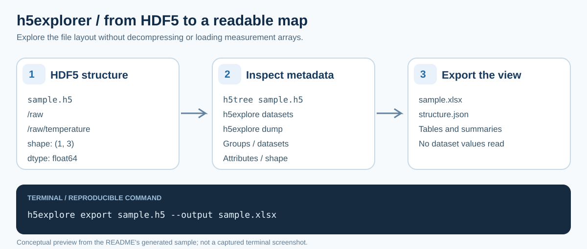

# h5explorer

[English](README.md) · 한국어

HDF5 파일의 구조와 메타데이터를 파이썬이나 명령줄에서 탐색합니다.



*실제 터미널 캡처가 아닌 개념도입니다. 설치 아래의 생성 샘플로 같은 과정을 따라 할 수 있습니다.*

h5py로 HDF5 파일을 읽어 그룹, 데이터셋, 속성을 pandas DataFrame으로 주고, Rich로 트리와 표를 출력하며,
Excel이나 JSON으로 내보냅니다.
메타데이터만 읽으므로 HDF5 필터 플러그인(bitshuffle, LZ4, Blosc 등, PAL-XFEL·Eiger 데이터)으로 압축된 파일도
`hdf5plugin` 없이 열립니다.

## 설치

Python 3.10 이상, [uv](https://docs.astral.sh/uv/). PyPI에는 올라가 있지 않으므로 clone해서 설치합니다.

```sh
git clone https://github.com/NaNIsaac/h5explorer.git
cd h5explorer
```

샘플 파일을 만들고 명령을 실행합니다.

<!-- test unix -->
```sh
uv venv --python 3.13
uv pip install .
.venv/bin/python -c "import h5py; f = h5py.File('sample.h5', 'w'); f.create_group('raw').create_dataset('temperature', data=[[1.0, 2.0, 3.0]]); f.close()"
.venv/bin/h5tree sample.h5
.venv/bin/h5explore export sample.h5 --output sample.xlsx
```

<!-- test windows -->
```powershell
uv venv --python 3.13
uv pip install .
.venv\Scripts\python -c "import h5py; f = h5py.File('sample.h5', 'w'); f.create_group('raw').create_dataset('temperature', data=[[1.0, 2.0, 3.0]]); f.close()"
.venv\Scripts\h5tree sample.h5
.venv\Scripts\h5explore export sample.h5 --output sample.xlsx
```

## 명령줄

`h5explore`는 명령 그룹입니다. `h5tree`는 `h5explore explore`와, `h5info`는 `h5explore datasets`와 같습니다.

```sh
h5explore explore data.h5                 # 그룹과 데이터셋 트리
h5explore explore data.h5 --summary       # 요약만
h5explore explore data.h5 --max-depth 2   # 깊이 제한
h5explore explore data.h5 --no-attrs      # 속성 숨기기
h5explore datasets data.h5 --top 20       # 큰 데이터셋 표
h5explore dump data.h5                    # 모든 그룹·데이터셋·속성을 한 줄씩 평문으로 (루트 포함)
h5explore export data.h5 --output analysis.xlsx                  # Excel (기본값)
h5explore export data.h5 --format json --output structure.json   # JSON
h5explore batch ./files --output-dir ./reports --recursive       # 폴더의 HDF5 파일 전부 리포트
h5explore compare a.h5 b.h5 c.h5          # 파일 비교
h5explore find ./files --recursive        # 폴더의 HDF5 파일 찾기
```

## 파이썬

```python
from h5explorer.core import H5Explorer

explorer = H5Explorer("data.h5")

explorer.show_summary()
explorer.show_tree(max_depth=3)
explorer.show_datasets_table(top_n=10)

datasets = explorer.get_datasets_info()        # pandas DataFrame
groups = explorer.get_groups_info()
attributes = explorer.get_attributes_info()
summary = explorer.get_file_summary()          # dict

explorer.export_to_excel("analysis.xlsx")      # 시트: Summary, Datasets, Groups, Attributes
explorer.export_structure_json("structure.json")
```

`H5Batch`, `find_large_datasets`, `analyze_compression_efficiency`, `get_dataset_paths`는 `h5explorer.cli`에 있습니다.

## 구조

```
h5explorer/
  core.py     H5Explorer: 스캔, DataFrame, Rich 출력, 내보내기
  cli.py      Click 명령, H5Batch, 보조 함수
tests/        pytest
pyproject.toml
```

## 테스트

<!-- test -->
```sh
uv run --group dev pytest
```
